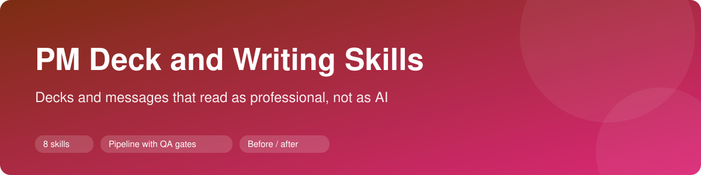
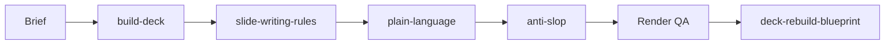

# PM deck and writing skills

Eight reusable skills for product managers who write decks, proposals and project messages: the rules, the pipeline and the quality gates. Each skill is a folder with a `SKILL.md` (frontmatter, instructions, checklist, examples, definition of done) that works with Claude Code and similar agents.

| Skill | What it does |
|---|---|
| [`slide-writing-rules`](skills/slide-writing-rules/SKILL.md) | Editorial rules for deck text: titles, anonymity, takeaways, no repeated slides, bold key points |
| [`concise-slide`](skills/concise-slide/SKILL.md) | A one-idea slide with a word budget and ready HTML and CSS |
| [`build-deck`](skills/build-deck/SKILL.md) | The pipeline from brief to delivered deck, with render QA |
| [`deck-rebuild-blueprint`](skills/deck-rebuild-blueprint/SKILL.md) | A two-file handoff so engineering can rebuild a deck |
| [`tech-pitch`](skills/tech-pitch/SKILL.md) | A six-block technical pitch that starts from the customer's pain |
| [`anti-slop`](skills/anti-slop/SKILL.md) | Rewrite text to remove AI tells, with a before and after table |
| [`plain-language`](skills/plain-language/SKILL.md) | Make material understandable on the first read |
| [`pm-communication`](skills/pm-communication/SKILL.md) | Eleven message types that work as the project record |

## How they fit together

The full flow with gates is in [`docs/deck-pipeline.md`](docs/deck-pipeline.md).

## Also included

- [`templates/`](templates): deck outline, blueprint and style-and-design file
- [`examples/`](examples): a fictional 8-slide outline and a before and after of weak titles and paragraphs

## Using a skill

Copy a folder from `skills/` into your project's `.claude/skills/` directory, then ask for it by name or describe the task. Adapt the tokens and component names in `templates/style-and-design.md` to your own design system.

## About the examples

All examples use a fictional company and product (Acme Field Sales Assistant). Every name, figure and date is made up for illustration. Nothing in this repository comes from a real client or employer.
