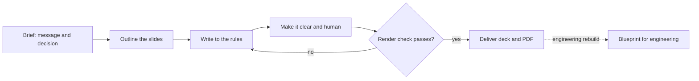

# PM deck and writing skills

Most decks and project messages fail before anyone touches the design: the title tells a story instead of a fact, the takeaway repeats the table, a person gets named, nothing carries a date, and the prose reads as generated. These eight skills fix that at the source. They are editorial rules, a build pipeline with gates, and two rewrite passes that make text clear and human, written as `SKILL.md` folders that work with Claude Code and other coding agents, and as plain Markdown anyone can read.

**See it live:** [an eight-slide pilot proposal built with these rules](https://benyoumen.github.io/pm-deck-and-writing-skills/). Fictional product, keyboard and swipe navigation, light and dark scheme, one page per slide when printed. The last slide lists the rules you can check on the screen.

## Start here

| If you... | Read, in this order |
|---|---|
| have a deck to build | [`build-deck`](skills/build-deck/SKILL.md), then [`slide-writing-rules`](skills/slide-writing-rules/SKILL.md), with [`templates/deck-outline.md`](templates/deck-outline.md) open and [`examples/acme-field-sales-assistant-outline.md`](examples/acme-field-sales-assistant-outline.md) as the model |
| have text that sounds like AI | [`anti-slop`](skills/anti-slop/SKILL.md), then [`plain-language`](skills/plain-language/SKILL.md); the rewrites in [`examples/before-after.md`](examples/before-after.md) show both at work |
| write status updates and project messages | [`pm-communication`](skills/pm-communication/SKILL.md): eleven message types, one structure each, readable in under a minute |

## Skills

| Skill | What it does |
|---|---|
| [`slide-writing-rules`](skills/slide-writing-rules/SKILL.md) | Fourteen editorial rules for deck text: titles, anonymity, verifiable claims, the takeaway block, dates, no repeated slides, bold key points |
| [`concise-slide`](skills/concise-slide/SKILL.md) | A one-idea slide with a word budget, four layouts and ready HTML and CSS |
| [`build-deck`](skills/build-deck/SKILL.md) | The pipeline from brief to delivered deck, with gates and a render QA |
| [`deck-rebuild-blueprint`](skills/deck-rebuild-blueprint/SKILL.md) | A two-file handoff so engineering can rebuild a deck by hand or through agents |
| [`tech-pitch`](skills/tech-pitch/SKILL.md) | A six-block technical pitch that opens on the customer's pain and closes on one request |
| [`anti-slop`](skills/anti-slop/SKILL.md) | Rewrite text to remove the tells of machine writing, facts untouched |
| [`plain-language`](skills/plain-language/SKILL.md) | Diagnose the seven comprehension blockers and make material understandable on the first read |
| [`pm-communication`](skills/pm-communication/SKILL.md) | Eleven message types that work as the official project record |

Every skill has the same shape: when to use, inputs, a numbered procedure, the rules, a checklist, an Acme example with a weak and a corrected version, a definition of done, and related skills.

## How they fit together



*One message in, one checked deck out; the words are made clear and human before anything is rendered.*

The full flow with its three gates is in [`docs/deck-pipeline.md`](docs/deck-pipeline.md). `tech-pitch` and `pm-communication` sit next to the pipeline: the first produces the script and brief for a customer-facing deck, the second writes the message that carries any deck or decision.

## Before and after

Two of the title rewrites from [`examples/before-after.md`](examples/before-after.md):

| Before | After | Rule applied |
|---|---|---|
| The Heart Of The Problem: Why Reps Skip The CRM | Why reps skip the CRM | Short, factual, sentence case, no dramatic phrasing |
| Our Journey Toward A Smarter Sales Process | Pilot status at the end of May | No journey metaphor; state the message |

The same file rewrites three paragraphs: a cliche opener, a claim with no validation criterion and a named person, and a conclusion that only recaps.

## Use

Copy a folder from `skills/` into your assistant's skills directory and ask for it by name, or describe the task.

- **Claude Code:** `.claude/skills/<name>/SKILL.md` in your project, or `~/.claude/skills/` for every project.
- **Codex, Cursor and other agents:** keep the folder anywhere and point to it from `AGENTS.md`, for example "Before writing a deck, read `skills/slide-writing-rules/SKILL.md` and `skills/build-deck/SKILL.md`."
- **People:** read the Markdown. The rules do not need an agent.

The frontmatter of each skill follows the Agent Skills format (`name`, `description`, `license`, `metadata`). Adapt the tokens and component names in [`templates/style-and-design.md`](templates/style-and-design.md) to your own design system.

## Folders

```
skills/      8 skills, one folder each (SKILL.md)
templates/   deck outline, rebuild blueprint, style-and-design file
examples/    a fictional 8-slide outline and a before and after
site/        the outline rendered as a live HTML deck (deployed by the Pages workflow)
docs/        pipeline diagram and sources
```

## About the examples

All examples use a fictional company and product, Acme and the Acme Field Sales Assistant, an AI agent that drafts follow-up emails and updates the CRM after customer meetings. Every name, figure and date is made up for illustration. Nothing in this repository comes from a client or an employer. Public references behind the rules are listed in [`docs/sources.md`](docs/sources.md).

## License

MIT. See [LICENSE](LICENSE).
