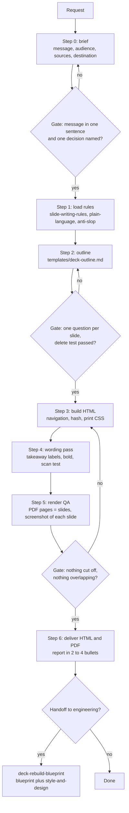

# Deck pipeline

How the skills in this repo fit together, from request to delivered deck.

## Which skill runs where

| Stage | Skill | Output |
|---|---|---|
| Brief and structure | `build-deck` | outline using `templates/deck-outline.md` |
| Titles, tone, takeaways | `slide-writing-rules` | text that passes the checklist |
| Breathing slides | `concise-slide` | one-idea slides |
| Clarity for non-specialists | `plain-language` | jargon defined, examples added |
| Natural prose | `anti-slop` | text without AI tells |
| Customer-facing proposal | `tech-pitch` | six-block script and deck |
| Stakeholder messages around the deck | `pm-communication` | the email or update that carries it |
| Handoff | `deck-rebuild-blueprint` | blueprint and style files |

## Gates in one place

1. **Brief gate:** the central message fits in one sentence and one decision is named.
2. **Outline gate:** every slide answers a different question; every figure has a unit and a source.
3. **Render gate:** PDF page count equals slide count, and every slide screenshot shows no overflow or overlap.
